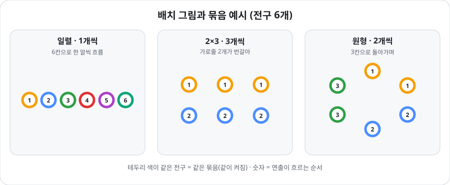

# 27. 전구 재탐색과 배치

다운라이트 제어기가 **어느 채널에 전구가 꽂혔는지 찾고**(재탐색), 그 전구들이 천장에 **어떻게 놓였는지**(배치), **어떤 전구끼리 같이 켜질지**(묶음), **연출이 어느 순서로 흐를지**(순서)를 정합니다.

기기 화면 → **⚙️ 설정 → 이 제어기 → 전구 재탐색 및 배치 ›**

| 오른쪽 표시 | 뜻 |
|---|---|
| `1개 · 배치 필요 없음` | 전구가 1개라 정할 것이 없습니다 |
| `배치 필요` | 전구가 2개 이상인데 아직 배치를 정하지 않았습니다 |
| `묶음 N개` | 배치를 저장했습니다 (N = 연출이 흐르는 칸 수) |
| `전구 없음` | 연결된 전구를 찾지 못했습니다 |

> 배치를 정하지 않고 닫아도 조명은 **채널 번호 순**(CH1 → CH6)으로 동작합니다.

---

## 1단계 · 재탐색

<!-- ⬜ 확인 필요: 화면 캡처 (images/27-dl-layout/01-intro.png, 02-busy.png, 03-result.png) -->

1. **재탐색 시작** 을 누릅니다.
2. 모든 전구가 잠깐 켜졌다가 **하나씩 차례로 꺼집니다**(약 5초). **"전구 찾는 중"** 이 끝날 때까지 기다려 주세요.
   - **닫기(계속 찾음)** 를 눌러도 재탐색은 계속됩니다.
3. **재탐색 결과** 에 연결된 전구 수와, 이전 결과와 같은지 다른지가 나옵니다.

이미 찾은 결과가 있으면 재탐색 없이 **지금 결과로 배치 정하기 ›** 를 눌러 바로 다음 단계로 갈 수 있습니다.

### 채널 표시 읽기

재탐색 결과에는 채널마다 칩이 하나씩 나옵니다.

| 칩 | 뜻 | 할 일 |
|---|---|---|
| **CHn 색온도** | 따뜻한 빛·차가운 빛 모두 정상 | 없음 |
| **CHn 따뜻한 빛만** / **CHn 차가운 빛만** | 두 줄 중 한 줄만 연결됨 — 그 전구는 색온도가 바뀌지 않습니다 | 배선을 확인하세요 |
| **CHn 따뜻한(차가운) 빛만 · 쇼트 쪽 제외** | 한 줄이 합선되어 그 줄을 끄고, 나머지 한 줄만 씁니다 | 배선의 합선을 확인하세요 |
| **CHn 제외 · 쇼트** | 두 줄 모두 합선 — 그 채널을 켜지 않습니다 | 배선의 합선을 확인하세요 |
| **CHn … · 맞지 않는 전구** | 이 보드에 맞지 않는 전구(전압이 낮아 밝기 조절 불가) — 켜지 않습니다 | 맞는 전구로 바꾸세요 |
| **CHn 확인 필요** | 상태를 판단하지 못했습니다 | **다시 찾기** 를 누르세요 |

> 재탐색이 끝나지 않으면 **"폴트·입력 전원을 확인한 뒤 다시 찾아 주세요"** 가 나옵니다. 이때 조명은 **이전 감지 결과로 다시 켜집니다.** → [30장](30-다운라이트-전원-보호)

## 2단계 · 배치 고르기

전구가 **2개 이상**이면 **배치 고르기 ›** 를 누릅니다.

<!-- ⬜ 확인 필요: 화면 캡처 (images/27-dl-layout/04-pick.png) -->

### 그림

연결된 전구 수에 맞는 천장 배치 그림이 나옵니다.

| 전구 수 | 고를 수 있는 그림 |
|---|---|
| 2개 | 일렬 |
| 3개 | 일렬 · 삼각 |
| 4개 | 일렬 · 2×2 |
| 5개 | 일렬 · 주사위 · 2+3 |
| 6개 | 일렬 · 2×3 · 3×2 · 원형 |

### 묶음 — 같은 색 = 같이 켜짐

같은 묶음의 전구는 **언제나 함께** 켜지고 바뀝니다. 연출은 묶음에서 묶음으로 흐릅니다.

버튼 이름은 한 묶음에 든 전구 수입니다. 그림마다 고를 수 있는 묶음이 다릅니다.

| 묶음 | 뜻 |
|---|---|
| **1개씩** | 전구마다 따로 — 연출이 전구 하나하나를 지나갑니다 |
| **2개씩 · 3개씩** | 전구를 2개(3개)씩 묶습니다. 격자 그림(2×2, 2×3, 3×2)에서는 그림의 가로줄 또는 세로줄 하나가 한 묶음이 됩니다 |
| **2·3 묶음** | 2+3 그림에서 윗줄 2개, 아랫줄 3개를 각각 묶습니다 |
| **한 묶음** | 전구 전체가 하나 — 연출이 흐르지 않고 모두 함께 바뀝니다 |

> 맞는 그림이 없으면 **＋ 위치 지정** 을 눌러 전구를 끌어 실제 위치로 옮길 수 있습니다(격자에 맞춰짐).

### 미리보기 — 번호 = 연출이 흐르는 순서

그림의 전구에 붙은 번호가 연출이 흐르는 순서입니다. 그림의 번호와 **실제 천장의 전구**를 맞추려면 아래 버튼을 씁니다.

| 버튼 | 하는 일 |
|---|---|
| **전구 확인** | 그림의 전구를 누르면 **그 전구만 3초** 켜집니다 — 번호와 실제 위치가 맞는지 확인합니다 |
| **자리 바꾸기** | 그림의 두 자리를 차례로 누르면 두 자리의 실제 전구가 맞바뀝니다 (번호는 자리에 남습니다) |
| **순서 매기기** | 연출이 흐를 순서대로 전구를 하나씩 누릅니다 |
| **순서 뒤집기** | 흐르는 방향을 반대로 바꿉니다 |
| **좌표 순서로** | 그림 속 전구 위치를 따라 순서를 다시 매깁니다 |

### 간격

**간격 · 전구 사이 빈 구간** 막대로 전구 사이를 넓힐 수 있습니다. → [28장](28-전구-간격과-상세-위치)

### 저장

**저장** 을 누르면 **"저장했습니다 — 전구 N개 · …"** 가 나옵니다.

> **"저장했지만 기기에 적용되지 않았습니다 — 다시 찾은 뒤 골라 주세요"** 가 나오면 1단계부터 다시 하세요.
> **"전구 정보가 맞지 않습니다 — 다시 찾아 주세요"** 는 배치를 고르는 동안 전구 연결이 바뀐 경우입니다.

## 언제 다시 하나요?

- 전구를 **더 꽂거나 뺐을 때**, 다른 채널로 **옮겨 꽂았을 때**
- 연출이 실제 천장 순서와 **다르게 흐를 때**
- 전구가 켜지지 않거나 색온도가 바뀌지 않을 때 (채널 표시로 원인 확인)

---

**← 이전** [[26. 설치와 처음 연결|26-다운라이트-설치와-연결]] · **다음 →** [[28. 전구 간격과 상세 위치|28-전구-간격과-상세-위치]]
