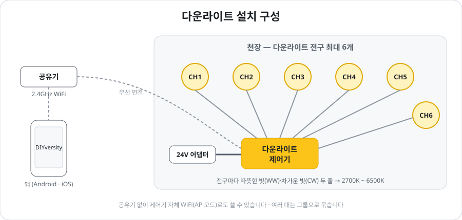

# 다운라이트 2. 제품 알아보기

**DIYversity 다운라이트 제어기**는 천장 다운라이트 전구를 최대 **6개**까지 연결해 폰으로 켜고, **밝기와 색온도**(따뜻한 빛 ↔ 차가운 빛)를 바꾸고, 전구에서 전구로 흐르는 연출을 넣는 WiFi 제어기입니다.
앱과 기기 화면은 라인조명 제어기와 같습니다. 이 다운라이트 섹션에서는 **다운라이트만 다른 부분**을 설명하고, 같은 부분은 앞 장으로 안내합니다.



---

## 제품의 특징

- 전구 **6개**까지, 전구마다 따뜻한 빛·차가운 빛을 섞어 **2700K ~ 6500K** 색온도를 냅니다.
- 꽂힌 전구를 **스스로 찾고**, 합선·한쪽 줄 빠짐·맞지 않는 전구를 알려 줍니다.
- 천장 **배치 그림**과 **묶음**을 정하면 연출이 실제 천장 순서대로 흐릅니다.
- **24V 입력 전류**를 실시간으로 재서 한계를 넘으면 곧바로 끊어 배선과 어댑터를 보호합니다.
- 루틴·시퀀스·그룹·무선 업데이트 같은 앱 기능을 라인조명 제어기와 똑같이 씁니다.

## 제품의 구성

*(구성품 사진 기입 예정)*

<!-- 구성품 사진 한 줄 (images/dl-product/box.png) — 제어기 · 전원 어댑터 · 전구(포함 여부) · 설명서 등 -->

| 구성품 | 포함 여부 |
|---|---|
| 다운라이트 제어기 | 기본 |
| 24V 전원 어댑터 | *(기입 예정)* |
| 다운라이트 전구 | *(기입 예정)* |
| 간단 설명서 / QR | *(기입 예정)* |

## 각 부분의 이름과 기능

*(각 부분 사진 기입 예정)*

<!-- 보드 사진에 번호를 붙인 그림 (images/dl-product/parts.png) -->

| 번호 | 이름 | 기능 |
|---|---|---|
| ① | 전원 입력 | 24V 어댑터를 연결합니다 (커넥터 종류: *기입 예정*) |
| ② | 전구 출력 CH1 ~ CH6 | 다운라이트 전구를 연결합니다. 채널마다 따뜻한 빛·차가운 빛 두 줄 |
| ③ | 초기화 버튼 | 길게 눌러 공장초기화합니다 → [아래 표](#버튼-동작에-따른-기능) |
| ④ | 외부 센서 커넥터 | 확장 장비(센서 등)를 연결합니다 (지원 센서: *기입 예정*) |

## 버튼 동작에 따른 기능

| 버튼 | 동작 | 기능 |
|---|---|---|
| 초기화 버튼 | 전원이 켜진 상태에서 **5초 이상** 누르기 | 공장초기화 → [공통 12장](공통-12-공장초기화) |

## 전구가 이렇게 보이면

다운라이트 제어기는 상태 표시등 대신 **전구의 모습**으로 지금 무엇을 하는지 보여 줍니다.

| 전구 모습 | 뜻 |
|---|---|
| 모든 전구가 잠깐 켜졌다가 **하나씩 차례로 꺼짐** (약 5초) | 전구 재탐색 중 → [다운라이트 4장](다운라이트-04-전구-재탐색과-배치) |
| **전구 하나만 3초** 켜짐 | 배치 화면에서 **전구 확인** 을 누름 |
| 빛이 전구에서 전구로 **몇 초 흐른 뒤** 원래대로 | 간격 **미리 보기** → [다운라이트 5장](다운라이트-05-전구-간격과-상세-위치) |
| 특정 전구만 **켜지지 않음** | 그 채널을 합선·맞지 않는 전구로 판단해 끔 → [다운라이트 8장](다운라이트-08-고장-신고-전-확인) |
| 전구 하나가 **색온도가 바뀌지 않음** | 그 전구의 한쪽 줄만 연결됨 |
| 모든 전구가 **잠깐 꺼졌다 다시 켜짐** | 전원 보호가 동작함 → [다운라이트 7장](다운라이트-07-전원-보호) |

## 라인조명 제어기와 다른 점

| | 라인조명 제어기 | 다운라이트 제어기 |
|---|---|---|
| 연결하는 것 | LED 스트립(라인) 한 줄 | 다운라이트 전구 최대 6개 (CH1 ~ CH6) |
| 조절할 수 있는 것 | 밝기 · 색상 · 연출 (제품에 따라 흰색·색온도) | **밝기 · 색온도** · 연출 (색상은 없습니다) |
| 연결 확인 | LED 개수 **자동 감지** | **전구 재탐색** — 어느 채널에 전구가 꽂혔는지 찾습니다 |
| 연출이 흐르는 단위 | LED 한 알(px) | 전구 **묶음** (함께 켜지는 전구들) |
| 전원 | LED 종류에 맞는 5V · 12V | **24V** 입력 |
| 설정 → 장비 표시 | `LINE … · 자동 인식` | `… · 보드 확인` |

## 할 수 있는 것

| 기능 | 설명 | 안내 |
|---|---|---|
| 폰으로 제어 | 켜기/끄기, 밝기, 색온도 2700K ~ 6500K | [다운라이트 6장](다운라이트-06-밝기-색온도-연출) |
| 전구 재탐색과 배치 | 연결된 전구를 찾고, 천장 배치 그림과 묶음, 연출 순서를 정합니다 | [다운라이트 4장](다운라이트-04-전구-재탐색과-배치) |
| 전구 간격 · 상세 위치 | 전구 사이 거리를 연출에 반영합니다 | [다운라이트 5장](다운라이트-05-전구-간격과-상세-위치) |
| 연출 | 숨쉬기·촛불 같은 밝기 변화, 전구에서 전구로 넘어가는 흐름 | [다운라이트 6장](다운라이트-06-밝기-색온도-연출) |
| 루틴 · 시퀀스 · 그룹 | 라인조명 제어기와 같습니다 | [공통 7장](공통-07-루틴) · [공통 11장](공통-11-시퀀스) · [공통 9장](공통-09-그룹-연결) |
| 전원 보호 | 입력 전류가 한계를 넘으면 곧바로 끊고 다시 켭니다 | [다운라이트 7장](다운라이트-07-전원-보호) |
| 무선 업데이트 | 앱에서 최신 펌웨어로 | [공통 4장](공통-04-펌웨어-업데이트) |

<!-- 검토 필요: 혼합 그룹(라인 + 다운라이트) 지원 여부 — 검증 끝나면 이 줄에 안내 추가 -->

## 준비물

- DIYversity 다운라이트 제어기 + 다운라이트 전구(최대 6개) + 24V 전원 어댑터
- 스마트폰 (안드로이드 또는 아이폰)
- (권장) **2.4GHz WiFi 공유기** — 5GHz 전용 WiFi에는 연결되지 않습니다

> 사양(크기·전원·무선)은 [다운라이트 9장 제품 규격](다운라이트-09-제품-규격)에 있습니다.

---

## 처음 설치 순서

```
① 전구·전원 연결  →  ② AP 모드로 접속  →  ③ 공유기 WiFi 연결  →  ④ 앱에서 기기 찾기  →  ⑤ 전구 재탐색과 배치
```

**← 이전** [[다운라이트 1. 안전을 위해 주의하기|다운라이트-01-안전-주의]] · **다음 →** [[다운라이트 3. 설치와 처음 연결|다운라이트-03-설치와-연결]] · [[처음으로|DIYversity-메뉴얼]]
