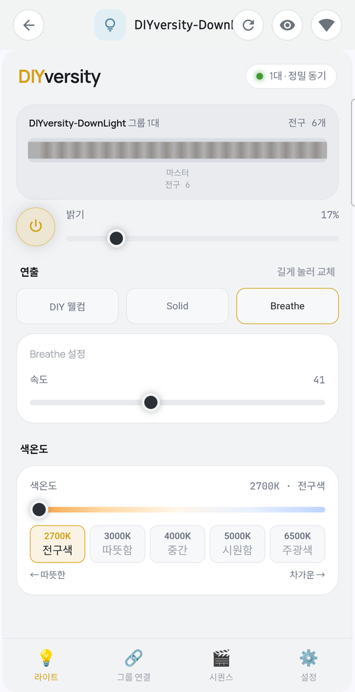
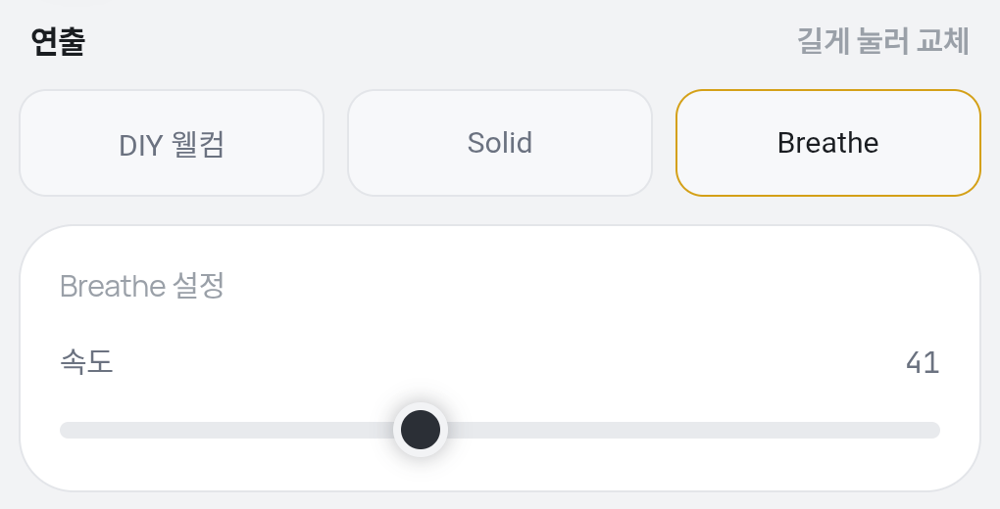

# 다운라이트 3. 라이트 — 밝기 · 색온도 · 연출

다운라이트의 **💡 라이트** 탭은 라인조명과 같은 자리에 있지만, **색상 대신 색온도**를 고릅니다. 켜기/끄기와 밝기는 [라인조명 3장](라인조명-03-라이트)과 같습니다.

---

## 색온도

**색온도** 막대를 움직이면 빛이 **← 따뜻한** ↔ **차가운 →** 사이에서 바뀝니다. 막대 위에 지금 값이 `3000K · 따뜻함` 처럼 나옵니다.

아래 버튼을 누르면 자주 쓰는 색온도로 바로 맞춥니다.

| 버튼 | 색온도 | 느낌 |
|---|---|---|
| **전구색** | 2700K | 백열등 같은 노란 빛 — 휴식, 침실 |
| **따뜻함** | 3000K | 따뜻한 흰빛 — 거실, 식탁 |
| **중간** | 4000K | 자연스러운 흰빛 |
| **시원함** | 5000K | 맑은 흰빛 — 작업, 주방 |
| **주광색** | 6500K | 한낮 햇빛 같은 푸른 흰빛 — 집중 |

> 한쪽 빛만 연결된 전구(재탐색 결과 **"… 빛만"**)는 색온도가 바뀌지 않고 연결된 빛만 냅니다. → [다운라이트 4장](다운라이트-04-제어기-설정)

## 연출

다운라이트는 색이 없기 때문에, **다운라이트에서 쓸 수 있는 연출만** 목록에 나옵니다. 목록 오른쪽에 종류가 표시됩니다.

| 종류 | 연출 | 설명 |
|---|---|---|
| **밝기 변화** | Solid · Breathe · Fade · Candle · DIY 웰컴 · DIY 웰컴(켜짐유지) · DIY 서서히 밝아짐 · DIY 서서히 어두움 · DIY 타이머 | 모든 전구의 밝기가 함께 바뀝니다 |
| **흐름(전구 2개 이상)** | Wipe · Sweep · Scan · Scan Dual · Scanner · Sinelon · Meteor · Chase · Gradient | 빛이 전구에서 전구로 넘어갑니다. **묶음이 2개 이상**일 때만 나옵니다 |

- 흐르는 순서와 방향은 [다운라이트 4장 배치](다운라이트-04-제어기-설정), 전구 사이 거리감은 [다운라이트 4장 간격](다운라이트-04-제어기-설정#전구-간격과-상세-위치)에서 정합니다.
- 연출 화면의 즐겨찾기 칸에는 처음에 Solid · Breathe · DIY 웰컴 · Fade · Candle 이 들어 있습니다.
- 속도·세기 같은 연출 설정은 [라인조명 3장](라인조명-03-라이트)과 같습니다.

## 루틴 · 시퀀스 · 그룹

- **루틴** — [공통 7장](공통-07-루틴)과 같습니다. <!-- 검토 필요: 루틴이 색온도까지 저장하는지 -->
- **시퀀스** — [공통 11장](공통-11-시퀀스)과 같습니다. 전원을 켤 때 서서히 밝아지기 같은 연출을 넣을 수 있습니다. → [라인조명 11장](라인조명-11-전원이-켜질-때-효과-넣기)
- **그룹** — 다운라이트끼리 마스터/슬레이브로 묶어 함께 켜고 끕니다. → [공통 9장](공통-09-그룹-연결)

---

**← 이전** [[다운라이트 2. 설치와 연결|다운라이트-02-설치와-연결]] · **다음 →** [[다운라이트 4. 제어기 설정|다운라이트-04-제어기-설정]] · [[처음으로|DIYversity-메뉴얼]]
