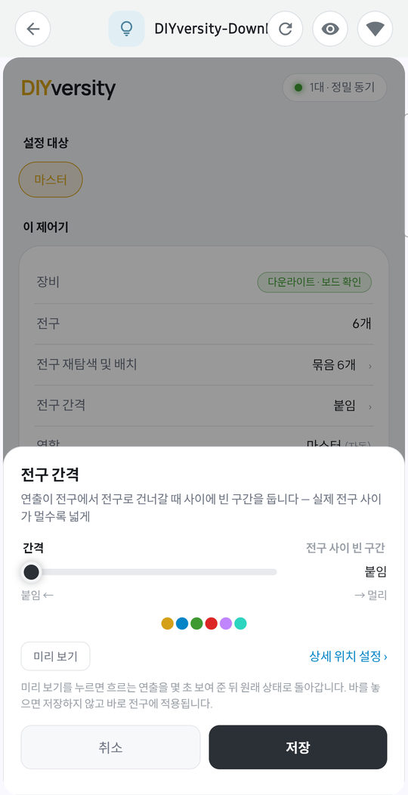
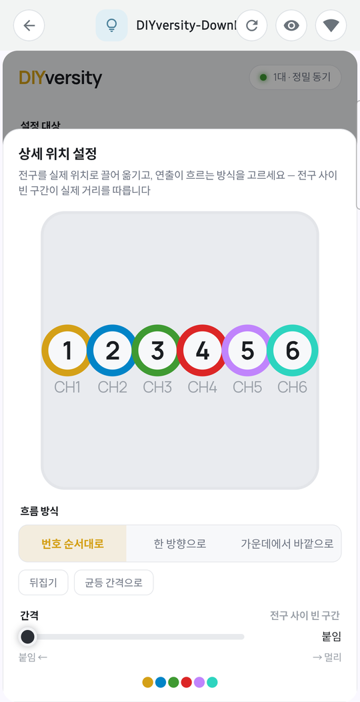

# 다운라이트 5. 전구 간격과 상세 위치

연출이 전구에서 전구로 건너갈 때 **사이에 빈 구간**을 둡니다. 실제 천장에서 전구 사이가 멀수록 넓게 두면, 빛이 그 거리를 지나가는 것처럼 자연스럽게 흐릅니다.

기기 화면 → **⚙️ 설정 → 이 제어기 → 전구 간격 ›**

- 이 줄은 **배치를 저장했고 묶음이 2개 이상**일 때만 나타납니다. → [다운라이트 4장](다운라이트-04-전구-재탐색과-배치)
- 오른쪽에 지금 값이 보입니다: `붙임` · `1칸` · `상세 위치 · 1.5칸` 등

 

---

## 간격 정하기

1. **간격 · 전구 사이 빈 구간** 막대를 움직입니다. 왼쪽 끝은 **붙임**(빈 구간 없음), 오른쪽으로 갈수록 **멀리**.
   - 막대를 놓으면 저장하지 않고 **바로 전구에 적용**됩니다. 실제 빛을 보며 맞추세요.
2. **미리 보기** 를 누르면 흐르는 연출을 몇 초(약 4초) 보여 준 뒤 원래 상태로 돌아갑니다.
3. **저장** 을 누릅니다. **취소** 를 누르면 이전 값으로 돌아갑니다.

> 저장하지 않고 둔 임시 값은 **10분 뒤** 저장된 값으로 돌아갑니다.

## 상세 위치 설정

전구 사이 거리가 **제각각**일 때 씁니다. **상세 위치 설정 ›** 을 누르세요.

1. 그림의 전구를 **끌어 실제 위치로** 옮깁니다. 전구 사이 빈 구간이 그림 속 거리를 따릅니다.
2. 전구를 누르면 **그 전구만 3초** 켜집니다 — 그림과 실제 위치를 맞춰 보세요.
3. **흐름 방식** 을 고릅니다.

| 흐름 방식 | 빛이 흐르는 모습 |
|---|---|
| **번호 순서대로** | 연출 순서대로 이은 점선을 따라, 점선 위의 거리만큼 사이를 둡니다 |
| **한 방향으로** | 화살표 방향으로 흐릅니다. 순서는 그 방향의 위치로 다시 매겨지고, 나란한 전구는 같이 켜집니다 |
| **가운데에서 바깥으로** | 가운데에서 바깥으로 퍼집니다(같은 거리 = 같이 켜짐). **뒤집기** 를 누르면 바깥에서 가운데로 모여듭니다 |

4. **완료** 를 누르면 간격 화면으로 돌아갑니다. 거기서 **저장** 해야 적용됩니다.

- **균등 간격으로** — 상세 위치를 지우고 모든 전구 사이를 같게 되돌립니다.
- **‹ 돌아가기** — 바꾼 내용을 버리고 돌아갑니다.

## 알아두세요

- 간격은 **흐름 연출**(Wipe, Sweep, Chase 등)에서만 보입니다. 숨쉬기·촛불처럼 밝기만 바뀌는 연출은 간격과 상관없습니다. → [다운라이트 6장](다운라이트-06-밝기-색온도-연출)
- 간격을 넓히면 연출 한 바퀴가 그만큼 길어집니다.

---

**← 이전** [[다운라이트 4. 전구 재탐색과 배치|다운라이트-04-전구-재탐색과-배치]] · **다음 →** [[다운라이트 6. 밝기 · 색온도 · 연출|다운라이트-06-밝기-색온도-연출]] · [[처음으로|DIYversity-메뉴얼]]
